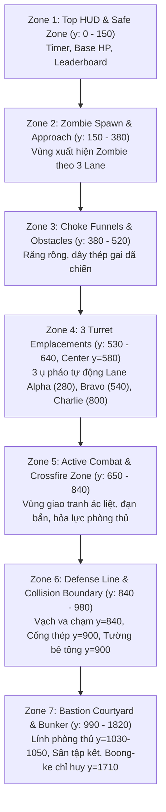

# ĐẶC TẢ KIẾN TRÚC VÀ BỐ CỤC CHUẨN THÀNH TRÌ BASTION (BASTION MASTER LAYOUT)

> **Dự án**: Zombie Đại Chiến: Thành Trì Cuối Cùng (2D 9:16 Server-Authoritative Live Defense Monorepo)  
> **Tài liệu**: Master Environment Layout Specification  
> **Nguồn cấu hình duy nhất (SSOT)**: [`apps/game-client/src/config/BastionGeometryConfig.ts`](file:///C:/Users/admin/.gemini/antigravity/scratch/zombie-live/apps/game-client/src/config/BastionGeometryConfig.ts)  
> **Bản đồ tham chiếu chuẩn (Master Reference)**: [`bastion_master_environment.png`](file:///C:/Users/admin/.gemini/antigravity/scratch/zombie-live/apps/game-client/public/assets/concept/bastion_master_environment.png)  
> **Ảnh đo đạc có lưới tọa độ**: [`bastion_geometry_verified.png`](file:///C:/Users/admin/.gemini/antigravity/scratch/zombie-live/apps/game-client/public/assets/concept/bastion_geometry_verified.png)  
> **Thời điểm cập nhật**: 2026-11-09  
> **Trạng thái**: ĐỒNG BỘ 100% VỚI MÃ NGUỒN VÀ SCENE RUNTIME (Cổng y=900, Turret y=580, Collision Boundary y=840).

---

## I. Hệ Tọa Độ & Nguyên Tắc Tỷ Lệ Hiển Thị (Scale Calibration)

### 1. Phân Biệt Không Gian Logic và Màn Hình Điện Thoại
- **Logic Canvas (Engine Space)**: `1080 × 1920 px` (Tỷ lệ 9:16 dọc).
- **Mobile Viewport (Màn hình thiết bị thực tế)**: `360 × 640 px` (Scale Factor: `1/3` hay `0.3333`).
- **Quy tắc quy đổi kích thước (P0 Calibration)**:
  $$\text{Pixel trên Mobile (360×640)} = \frac{\text{Pixel trên Canvas Logic (1080×1920)}}{3}$$

> [!IMPORTANT]
> - Chiều cao hiển thị chuẩn logic của nhân vật: **132px** (Trên mobile 360×640 hiển thị: **44.0px**).
> - Đảm bảo người xem livestream nhìn rõ quân phục, vũ khí và zombie mà không bị teo nhỏ.

---

## II. Phân Tầng Chiến Trường Trục Dọc (Vertical Zonation)

Chiến trường được phân chia thành 7 phân khu chức năng mạch lạc theo chiều dọc từ trên xuống dưới, đồng bộ chính xác với hệ tọa độ đo đạc thực tế:

---

## III. Hệ Thống 3 Lane Phòng Thủ (3 Defense Lanes)

Chiến trường được chia thành 3 làn chiến thuật tương ứng với 3 tiểu đội Alpha, Bravo, Charlie:

| Làn Gameplay | Tên Tiểu Đội | Tọa Độ Tâm Trục X | Giới Hạn Chiều Ngang | Vị Trí Bệ Pháo (Turret Pad) | Vạch Va Chạm (Collision Boundary) | Vị Trí Lính Phòng Thủ (Soldier) |
| :--- | :---: | :---: | :---: | :---: | :---: | :---: |
| **Lane 0** | **Alpha Squad** | **x = 280** | x: 80 ➔ 410 | (280, 580) | (280, 840) — Tường Trái | (280, 1030) |
| **Lane 1** | **Bravo Squad** | **x = 540** | x: 410 ➔ 670 | (540, 580) | (540, 840) — Cổng Thép | (540, 1050) |
| **Lane 2** | **Charlie Squad** | **x = 800** | x: 670 ➔ 1000 | (800, 580) | (800, 840) — Tường Phải | (800, 1030) |

---

## IV. Bảng Tọa Độ & Kích Thước Các Công Trình Kiến Trúc Chuẩn

Toàn bộ tọa độ bên dưới trùng khớp 100% với file cấu hình [`BastionGeometryConfig.ts`](file:///C:/Users/admin/.gemini/antigravity/scratch/zombie-live/apps/game-client/src/config/BastionGeometryConfig.ts) và scene [`ArtIntegrationLabScene.ts`](file:///C:/Users/admin/.gemini/antigravity/scratch/zombie-live/apps/game-client/src/scenes/ArtIntegrationLabScene.ts):

| Đối Tượng Kiến Trúc | Kích Thước Logic (px) | Kích Thước Mobile (px) | Tọa Độ Tâm (x, y) | Điểm Neo (Origin) | Tầng Sâu (Depth) | Ranh Giới Va Chạm (Collision) |
| :--- | :---: | :---: | :---: | :---: | :---: | :--- |
| **Mặt Nền Sân Căn Cứ** | 1080 × 1920 | 360 × 640 | (540, 960) | (0.5, 0.5) | **1** | Không (Nền sàn) |
| **Vạch Va Chạm Phòng Tuyến**| 960 × 6 | 320 × 2 | (540, 840) | (0.5, 0.5) | **5** | **y = 840** (Chặn Zombie cả 3 Lane) |
| **Khung Cổng Blast Gate** | 300 × 160 | 100 × 53 | (540, 900) | (0.5, 0.5) | **7** | Khung cổng cố định |
| **Cánh Cửa Trái (Trượt)** | 115 × 120 | 38 × 40 | Đóng: (483, 908) ➔ Mở: (430, 908) | (0.5, 0.5) | **6** | Trượt ngang $\Delta x = -53\text{px}$ |
| **Cánh Cửa Phải (Trượt)**| 115 × 120 | 38 × 40 | Đóng: (597, 908) ➔ Mở: (650, 908) | (0.5, 0.5) | **6** | Trượt ngang $\Delta x = +53\text{px}$ |
| **Tường Thành Trái** | 320 × 120 | 107 × 40 | (240, 900) | (0.5, 0.5) | **7** | Chặn vĩnh viễn tại y = 840 (Alpha) |
| **Tường Thành Phải** | 320 × 120 | 107 × 40 | (840, 900) | (0.5, 0.5) | **7** | Chặn vĩnh viễn tại y = 840 (Charlie) |
| **Bệ Pháo Alpha** | 130 × 130 | 43 × 43 | (280, 580) | (0.5, 0.5) | **8** | Bệ bê tông lục giác |
| **Bệ Pháo Bravo** | 130 × 130 | 43 × 43 | (540, 580) | (0.5, 0.5) | **8** | Bệ bê tông lục giác trung tâm |
| **Bệ Pháo Charlie** | 130 × 130 | 43 × 43 | (800, 580) | (0.5, 0.5) | **8** | Bệ bê tông lục giác |
| **Ụ Pháo Tự Động (3 ụ)** | Base 80px, Gun 80px | Base 27px, Gun 27px | (280, 580), (540, 580), (800, 580) | (0.5, 0.7) | **9–10** | Xoay 360° theo mục tiêu từng lane |
| **Lính Soldier Alpha** | Display 132px | Display 44.0px | (280, 1030) (Nấp sau tường y: 860) | (0.5, 0.5) | **11 / 4** | Occlusion: Depth 4 nấp sau tường Depth 7 |
| **Lính Soldier Bravo** | Display 132px | Display 44.0px | (540, 1050) | (0.5, 0.5) | **11** | Đứng bảo vệ trước hành lang cổng |
| **Lính Soldier Charlie** | Display 132px | Display 44.0px | (800, 1030) | (0.5, 0.5) | **11** | Điểm tựa cover cánh phải |
| **Zombie Walker (9 con)** | Display 132px | Display 44.0px | Di chuyển y: 230 ➔ 840 | (0.5, 0.5) | **12** | 3 con/lane; dừng tại vạch va chạm y=840 |
| **Sân Căn Cứ (Courtyard)** | 880 × 500 | 293 × 167 | Tâm (540, 1340), y: 1090..1590 | (0.5, 0.5) | **1** | Vùng di chuyển tiếp viện phía sau |
| **Boong-ke Chỉ Huy** | 360 × 150 | 120 × 50 | Tâm (540, 1710), y: 1640..1780 | (0.5, 0.5) | **13** | Sở chỉ huy bọc thép phía sau |
| **Kho Đạn Hậu Cần** | 180 × 120 | 60 × 40 | Tâm (220, 1720), y: 1660..1780 | (0.5, 0.5) | **13** | Hòm đạn xanh rêu và thùng phuy |

---

## V. Quy Tắc Va Chạm Động (Dynamic Collision Rules)

Hệ thống va chạm `BastionCollisionSystem` tuân thủ các quy tắc hình học:
1. **Khi Cổng Đóng (`GATE_CLOSED`)**:
   - Vạch va chạm liên tục từ $x=80$ đến $x=1000$ tại $y=840$.
   - Mọi Zombie ở cả 3 lane bị chặn đứng tại $y=840$, không thể xuyên qua.
2. **Khi Cổng Mở (`GATE_OPEN`)**:
   - Đoạn thông đạo trung tâm $x \in [410, 670]$ được mở thông.
   - Zombie tại Lane Bravo được phép di chuyển qua $y=840$, tiến vào hành lang sâu đến $y=940$.
   - Lane Alpha ($x \in [80, 410]$) và Lane Charlie ($x \in [670, 1000]$) **vẫn bị tường chặn 100% tại $y=840$**.
3. **Khi Cổng Đang Đóng (`GATE_CLOSING`)**:
   - Nếu Zombie chưa vượt qua $y=840$, cánh cửa trượt đóng lại và đẩy/chặn Zombie ở lại phía bắc $y=840$.
