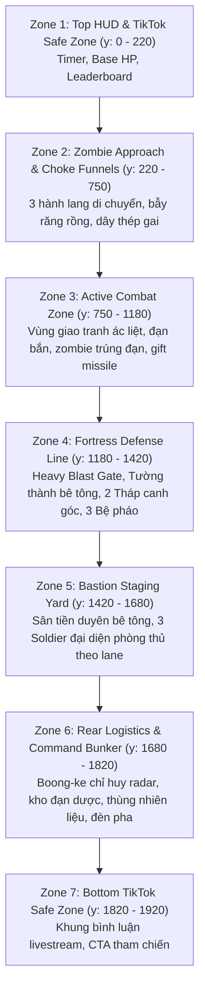

# ĐẶC TẢ KIẾN TRÚC VÀ BỐ CỤC CHUẨN THÀNH TRÌ BASTION (BASTION MASTER LAYOUT)

> **Dự án**: Zombie Đại Chiến: Thành Trì Cuối Cùng (2D 9:16 Server-Authoritative Live Defense Monorepo)  
> **Tài liệu**: Master Environment Layout Specification  
> **Bản đồ tham chiếu chuẩn (Master Reference)**: [`bastion_master_environment.png`](file:///C:/Users/admin/.gemini/antigravity/scratch/zombie-live/apps/game-client/public/assets/concept/bastion_master_environment.png) (Được chuẩn hóa từ `fortress_concept_bastion_1080x1920.png` đã được phê duyệt)  
> **Thời điểm cập nhật**: 2026-11-08  
> **Trạng thái**: Thống nhất 100% tọa độ kiến trúc, 3 lane gameplay và quy chuẩn tỷ lệ hiển thị giữa Logic Canvas (1080×1920) và Mobile Viewport (360×640).

---

## I. Hệ Tọa Độ & Nguyên Tắc Tỷ Lệ Hiển Thị (Scale Calibration)

### 1. Phân Biệt Không Gian Logic và Màn Hình Điện Thoại
- **Logic Canvas (Engine Space)**: `1080 × 1920 px` (Tỷ lệ 9:16 dọc).
- **Mobile Viewport (Màn hình thiết bị thực tế)**: `360 × 640 px` (Scale Factor: `1/3` hay `0.3333`).
- **Quy tắc quy đổi kích thước (P0 Calibration)**:
  $$\text{Pixel trên Mobile (360×640)} = \frac{\text{Pixel trên Canvas Logic (1080×1920)}}{3}$$

> [!IMPORTANT]
> **Khắc phục lỗi nhân vật bị teo nhỏ (14.7px) trên điện thoại**:
> - Trước đây tài liệu đề xuất nhân vật có `Display Height = 44px` trong canvas logic, dẫn đến khi hiển thị trên điện thoại `360×640`, nhân vật chỉ còn `44 / 3 ≈ 14.7px` (nhỏ như đầu tăm, người xem livestream không thể nhìn rõ).
> - **Tiêu chuẩn mới đã hiệu chỉnh**:
>   - Mục tiêu hiển thị trên điện thoại: **Chiều cao nhân vật từ 40px đến 44px**.
>   - **Chiều cao trong Logic Canvas 1080×1920 bắt buộc phải là**:
>     $$H_{\text{logic}} = 44\text{px} \times 3 = 132\text{px}$$
>   - Soldier: Chiều cao hiển thị chuẩn logic: **132px** (Trên mobile hiển thị: **44px**).
>   - Zombie Walker: Chiều cao hiển thị chuẩn logic: **132px** (Trên mobile hiển thị: **44px**).
>   - Boss Zombie King: Chiều cao hiển thị chuẩn logic: **198px** (Trên mobile hiển thị: **66px**).

---

## II. Phân Tầng Chiến Trường Trục Dọc (Vertical Zonation)

Chiến trường được phân chia thành 7 phân khu chức năng mạch lạc theo chiều dọc từ trên xuống dưới, đảm bảo cân bằng hoàn hảo giữa vùng an toàn TikTok và không gian giao tranh khốc liệt:

---

## III. Hệ Thống 3 Lane Phòng Thủ (3 Defense Lanes)

Chiến trường được chia thành 3 làn chiến thuật tương ứng với 3 tiểu đội Alpha, Bravo, Charlie:

| Làn Gameplay | Tên Tiểu Đội | Tọa Độ Tâm Trục X | Giới Hạn Chiều Ngang | Vị Trí Cửa Phễu (Choke Funnel) | Vị Trí Bệ Pháo (Turret Pad) | Vị Trí Lính Phòng Thủ (Soldier) |
| :--- | :---: | :---: | :---: | :---: | :---: | :---: |
| **Lane 0** | **Alpha Squad** | **x = 280** | x: 140 ➔ 410 | (280, 720) | (280, 1320) | (280, 1390) |
| **Lane 1** | **Bravo Squad** | **x = 540** | x: 410 ➔ 670 | (540, 720) - Trước Cổng Chính | (540, 1340) | (540, 1410) |
| **Lane 2** | **Charlie Squad** | **x = 800** | x: 670 ➔ 940 | (800, 720) | (800, 1320) | (800, 1390) |

---

## IV. Bảng Tọa Độ & Kích Thước Các Công Trình Kiến Trúc Chuẩn

Dựa trên bản đồ tham chiếu chuẩn [`bastion_master_environment.png`](file:///C:/Users/admin/.gemini/antigravity/scratch/zombie-live/apps/game-client/public/assets/concept/bastion_master_environment.png):

| Đối Tượng Kiến Trúc | Kích Thước Logic (px) | Kích Thước Mobile (px) | Tọa Độ Tâm (x, y) | Điểm Neo (Origin) | Tầng Sâu (Depth) | Mô Tả Hình Học & Vai Trò |
| :--- | :---: | :---: | :---: | :---: | :---: | :--- |
| **Mặt Nền Sân Căn Cứ** | 1080 × 1920 | 360 × 640 | (540, 960) | (0.5, 0.5) | **1** | Bê tông dã chiến có khe co giãn, vạch sơn chevron |
| **Rào Cản Dây Thép Gai** | 160 × 45 | 53 × 15 | (280, 700), (800, 700) | (0.5, 0.5) | **3** | Bẫy làm chậm zombie ở hai cánh |
| **Cọc Bê Tông Răng Rồng** | 180 × 60 | 60 × 20 | (410, 760), (670, 760) | (0.5, 0.5) | **3** | Rào cản phân cách 3 luồng di chuyển |
| **Tường Thành Trái** | 420 × 120 | 140 × 40 | (250, 1250) | (0.5, 0.5) | **4** | Tường bê tông cốt thép khối dày, có lỗ châu mai |
| **Tường Thành Phải** | 420 × 120 | 140 × 40 | (830, 1250) | (0.5, 0.5) | **4** | Tường bê tông cốt thép đối xứng bên phải |
| **Khung Cổng Blast Gate** | 300 × 150 | 100 × 50 | (540, 1250) | (0.5, 0.5) | **5** | Khung cổng thép chịu lực cố định |
| **Cánh Cổng Thép (Trượt)**| 240 × 120 | 80 × 40 | (540, 1250) | (0.5, 0.5) | **6** | Cổng thép cơ giới dập gân, pít-tông thủy lực |
| **Tháp Canh Góc Trái** | 240 × 240 | 80 × 80 | (110, 1220) | (0.5, 0.5) | **7** | Tháp canh tròn tiền đồn có bao cát đỉnh |
| **Tháp Canh Góc Phải** | 240 × 240 | 80 × 80 | (970, 1220) | (0.5, 0.5) | **7** | Tháp canh tròn tiền đồn có đèn pha rọi |
| **Bệ Pháo Alpha** | 150 × 150 | 50 × 50 | (280, 1320) | (0.5, 0.5) | **8** | Bệ pháo lục giác dập đinh tán |
| **Bệ Pháo Bravo** | 150 × 150 | 50 × 50 | (540, 1340) | (0.5, 0.5) | **8** | Bệ pháo trung tâm nâng cao |
| **Bệ Pháo Charlie** | 150 × 150 | 50 × 50 | (800, 1320) | (0.5, 0.5) | **8** | Bệ pháo lục giác bên phải |
| **Ụ Pháo Tự Động (3 ụ)** | Base 96px, Gun 80px | Base 32px, Gun 27px | Trùng bệ pháo | (0.5, 0.65) | **9–10** | Xoay 360°, nòng súng kép giật nòng |
| **Lính Soldier Alpha** | Display 132px | Display 44px | (280, 1390) | (0.5, 0.5) | **11** | Soldier đại diện Alpha nâng súng nhắm |
| **Lính Soldier Bravo** | Display 132px | Display 44px | (540, 1410) | (0.5, 0.5) | **11** | Soldier đại diện Bravo trung phong |
| **Lính Soldier Charlie** | Display 132px | Display 44px | (800, 1390) | (0.5, 0.5) | **11** | Soldier đại diện Charlie nâng súng nhắm |
| **Zombie Walker (8–10 con)**| Display 132px | Display 44px | Di chuyển y: 300 ➔ 1200 | (0.5, 0.5) | **12** | Tiến công theo 3 lane, dính đạn, ngã gục |
| **Boong-ke Chỉ Huy** | 340 × 150 | 113 × 50 | (540, 1740) | (0.5, 0.5) | **13** | Boong-ke bọc thép kiên cố phía sau |
| **Chảo Ăng-ten Radar** | 72 × 72 | 24 × 24 | (540, 1690) | (0.5, 0.5) | **14** | Chảo radar xoay tròn 360° |
| **Kho Đạn Dược Quân Sự** | 160 × 90 | 53 × 30 | (240, 1740) | (0.5, 0.5) | **13** | Hòm đạn xanh rêu và thùng phuy tiếp vận |
| **Đèn Chiếu & Máy Phát** | 140 × 80 | 47 × 27 | (840, 1740) | (0.5, 0.5) | **13** | Cụm máy phát điện và đèn pha hậu cần |
| **HUD TikTok LIVE** | Tỷ lệ chuẩn 1080 | Tỷ lệ chuẩn 360 | Header y: 120, Footer y: 1870 | (0.5, 0.5) | **20** | Vùng an toàn hiển thị chỉ số rõ nét |

---

## V. Hướng Nhìn Camera & Phép Chiếu (Camera Projection)

- **Góc nhìn**: Top-Down 2.5D (Bird's-Eye View với góc nghiêng khoảng `78°` từ trên xuống).
- **Đặc trưng thị giác**:
  - Bề mặt sàn, đường di chuyển và đỉnh đầu nhân vật/quái vật được nhìn thấy rõ ràng từ trên đỉnh xuống.
  - Mặt trước của tường thành bê tông, cổng thép, tháp canh và boong-ke chỉ huy có độ dày khối 3D (Extruded height) đổ bóng xiên nhẹ về phía nam.
  - Sprite Survivor Player và Zombie Walker của Riley Gombart (vốn có góc nhìn top-down hơi chếch đỉnh) hoàn toàn đồng điệu và hòa hợp tự nhiên vào mặt sân khi được đặt tại độ cao hiển thị chuẩn 132px.
