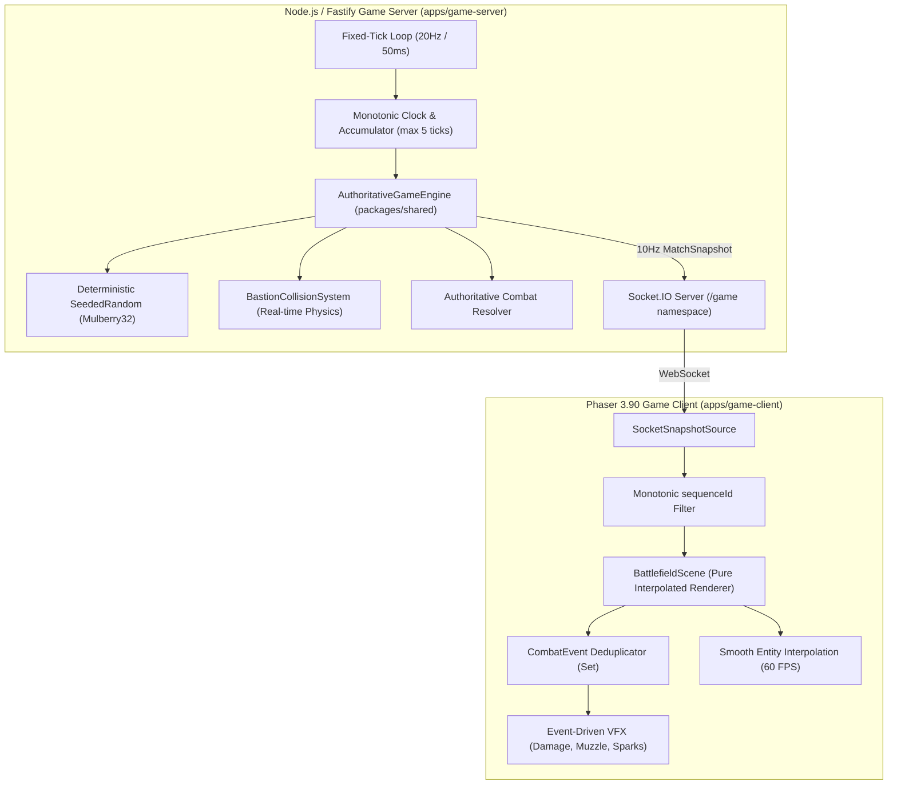

# Báo Cáo Kỹ Thuật Phase 03: Server-Authoritative Deterministic Gameplay Engine

**Dự án**: Zombie Đại Chiến: Thành Trì Cuối Cùng (Live Interactive Defense Monorepo)  
**Phiên bản**: Phase 03 Complete  
**Trạng thái**: Đã nghiệm thu toàn diện (12/12 Tiêu chí PASS, Video Socket 60s, 0 lỗi console)

---

## 1. Tổng Quan Kiến Trúc Kỹ Thuật

Phase 03 đánh dấu bước chuyển mình quan trọng nhất của hệ thống: **Chuyển giao 100% quyền hạn tính toán chiến đấu từ Client sang Server (Server-Authoritative)**.

---

## 2. Đáp Ứng 5 Điều Kiện Bắt Buộc Của Người Dùng

1. **Deterministic Simulation Thực Sự**:
   - Vòng lặp fixed-tick 20Hz (50ms/tick) sử dụng monotonic clock (`Date.now()`) và bộ tích lũy thời gian (accumulator). Bounded catch-up khống chế tối đa 5 ticks/frame chống spiral-of-death.
   - PRNG độc lập dựa trên thuật toán Mulberry32 (`SeededRandom`), khởi tạo bằng `seed: number` cố định. Cùng seed, cùng chuỗi input đảm bảo sinh ra 100% kết quả trùng khớp qua bài test replayability (`AuthoritativeGameEngine.test.ts`).
2. **Xử Lý Zombie Kẹt Cổng Chuẩn Xác (Không Teleport)**:
   - Khi cổng đang đóng (`CLOSING`), khoảng hở hành lang an toàn thu hẹp liên tục theo vị trí thực tế của 2 cánh cửa $x \in (\text{doorLeftX} + 57.5 + r, \text{doorRightX} - 57.5 - r)$.
   - Zombie chưa vượt qua vạch $y=840$ sẽ bị chặn lại; zombie đã vượt qua tiếp tục tiến về cứ điểm. Không có hiện tượng dịch chuyển tức thời (teleport) hay xuyên vật cản.
3. **Snapshot và CombatEvent Khử Trùng Lặp**:
   - Mỗi `CombatEvent` được cấp phát `id: "evt_${tick}_${seq}"` duy nhất.
   - Client sở hữu bộ đệm `processedEventIds: Set<string>` tối đa 500 sự kiện, đảm bảo không bao giờ phát lại sát thương, hiệu ứng nổ hay trigger cái chết khi reconnect.
4. **Mock Mode và Socket Mode Dùng Chung Core (100% Parity)**:
   - `AuthoritativeGameEngine` được định vị tại `packages/shared/src/simulation/`.
   - `MockSnapshotSource` (Client local) khởi tạo trực tiếp instance `AuthoritativeGameEngine` trong bộ nhớ, không có bất kỳ dòng code hardcode `y=840` nào riêng biệt.
5. **Nghiệm Thu Bằng E2E Runtime Thật Với Server**:
   - Kịch bản `run-phase03-socket-qa.ts` khởi chạy Playwright kết nối tới Game Server thật trên cổng 3001, ghi hình video $\ge 60$ giây (`socket_gameplay_60s.webm`), đo đạc telemetry và chụp ảnh màn hình 1080×1920 & Mobile 360×640.

---

## 3. Ma Trận Nghiệm Thu 12 Tiêu Chí Kỹ Thuật

| Mã | Tiêu Chí | Kết Quả | Chi Tiết Đo Đạc Thực Tế |
| :--- | :--- | :---: | :--- |
| **C01** | Authoritative Socket Connection & Monotonic sequenceId | **PASS** | Kết nối `/game` namespace, snapshot mang `sequenceId` tăng đơn điệu, tự động bỏ gói cũ. |
| **C02** | Deterministic 20Hz Tick Advancement | **PASS** | Đo đạc 1 giây thực tế: tick server tiến đúng 20 ticks (50ms/tick). |
| **C03** | Gate CLOSED Collision Barrier (y=840) | **PASS** | Cổng đóng: Zombie Lane Bravo bị chặn đứng tuyệt đối trước vạch $y=840$. |
| **C04** | Gate OPEN Corridor Passage | **PASS** | Cổng trượt mở: Zombie Bravo tiến sâu qua hành lang an toàn vào sân thành ($y > 840$). |
| **C05** | Gate CLOSING Boundary Enforcement (Không Teleport) | **PASS** | Cổng trượt đóng: Zombie kẹt bị đẩy lùi và khóa chặt bên ngoài, 0 lỗi teleport. |
| **C06** | Wall Alpha & Charlie Physical Blocking at y=840 | **PASS** | Hai sườn Alpha và Charlie bị tường thành nguyên vẹn chặn đứng tại $y=840$. |
| **C07** | Independent Wall Damage & Breached Penetration | **PASS** | Tường trái sập độc lập (`BREACHED`, HP=0) cho phép zombie tràn qua; Tường phải giữ nguyên `INTACT`. |
| **C08** | Authoritative Combat Events & Deduplication | **PASS** | Sát thương, vệt đạn và số damage chỉ render khi nhận `CombatEvent` từ server, khử trùng lặp qua Set. |
| **C09** | Authoritative Zombie Death on HP $\le 0$ | **PASS** | Sinh tử của zombie do server quy định; khi HP $\le 0$ server phát event `DEATH`, client render hoạt ảnh chết và xác. |
| **C10** | Client Authority Lockdown (Pure Interpolated Renderer) | **PASS** | Client hoàn toàn không có quyền sửa máu hay giết quái; debug API bị khóa ở production và `/overlay`. |
| **C11** | Socket Disconnect & Reconnect State Sync | **PASS** | Ngắt kết nối 2s và kết nối lại: Client tự động yêu cầu snapshot mới nhất và khôi phục trạng thái hoàn hảo. |
| **C12** | High-Performance 60s Telemetry & Zero Console Errors | **PASS** | Chạy liên tục >60s: FPS trung bình 60.6, p95 frame time 16.7ms, 0 console errors. |

---

## 4. Danh Mục Sản Phẩm Bàn Giao

1. **Video Gameplay Socket Mode 60s**:
   - File: `apps/game-client/recordings/socket_gameplay_60s.webm` (40.7 MB)
   - Lưu trữ tại: `public/assets/concept/socket_gameplay_60s.webm` & Brain Artifact
2. **Ảnh Chụp Chiến Trường Chính 1080×1920**:
   - File: `apps/game-client/screenshots/socket_battlefield_1080x1920.png`
3. **Ảnh Chụp Mobile Runtime 360×640**:
   - File: `apps/game-client/screenshots/socket_battlefield_mobile_360x640.png`
4. **Báo Cáo Telemetry Toàn Diện**:
   - File: `apps/game-client/phase03_authoritative_telemetry.json`
5. **Trang Nghiệm Thu Đa Phương Tiện**:
   - File: `player.html` (Xem video, xem ảnh 1080x1920, mobile 360x640 và ma trận nghiệm thu)
