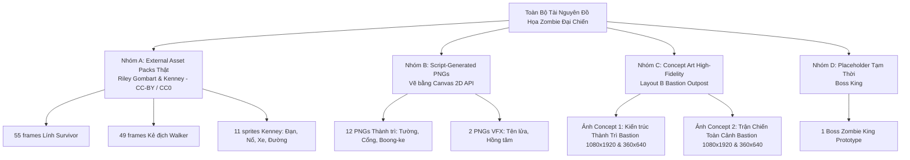

# BÁO CÁO ĐỐI CHIẾU VÀ PHÂN LOẠI MINH BẠCH TÀI NGUYÊN (ART ASSET AUDIT & RECONCILIATION)

> **Dự án**: Zombie Đại Chiến: Thành Trì Cuối Cùng (2D 9:16 Server-Authoritative Live Defense Monorepo)  
> **Cột mốc**: ART APPROVAL GATE (Giai đoạn phê duyệt định hướng mỹ thuật Thành Trì)  
> **Thời điểm cập nhật**: 2026-11-07  
> **Trạng thái**: Minh bạch hóa 100% nguồn gốc, làm rõ sai lệch số lượng 14 vs 12 PNG và phân loại danh mục asset.

---

## I. Giải Trình Sự Khác Biệt Giữa 14 PNG Được Tạo và 12 Asset Được Liệt Kê

Tại Phase 02.5, script `apps/game-client/scripts/generate-fortress-assets.ts` đã khởi tạo tổng cộng **14 file PNG**. Sự chênh lệch số lượng trong báo cáo trước đây xảy ra do cách phân loại thư mục lưu trữ:

| STT | Tên File Asset | Kích Thước | Thư Mục Lưu Trữ | Danh Mục Phân Loại |
| :---: | :--- | :---: | :--- | :--- |
| 1 | `fortress_main_gate.png` | 260×120 px | `public/assets/environment/fortress/` | Kiến trúc thành trì (Cổng chính) |
| 2 | `fortress_gate_damaged.png` | 260×120 px | `public/assets/environment/fortress/` | Kiến trúc thành trì (Cổng nứt vỡ) |
| 3 | `fortress_wall_left.png` | 410×90 px | `public/assets/environment/fortress/` | Kiến trúc thành trì (Tường trái) |
| 4 | `fortress_wall_right.png` | 410×90 px | `public/assets/environment/fortress/` | Kiến trúc thành trì (Tường phải) |
| 5 | `fortress_turret_platform.png` | 130×130 px | `public/assets/environment/fortress/` | Kiến trúc thành trì (Bệ pháo bát giác) |
| 6 | `fortress_sandbags.png` | 120×60 px | `public/assets/environment/fortress/` | Phòng tuyến dã chiến (Bao cát) |
| 7 | `fortress_barricade.png` | 110×55 px | `public/assets/environment/fortress/` | Phòng tuyến dã chiến (Rào chắn thép) |
| 8 | `fortress_ammo_storage.png` | 130×80 px | `public/assets/environment/fortress/` | Hậu cần căn cứ (Kho hòm đạn) |
| 9 | `fortress_command_center.png` | 280×110 px | `public/assets/environment/fortress/` | Hậu cần căn cứ (Boong-ke chỉ huy) |
| 10 | `fortress_spotlight.png` | 64×64 px | `public/assets/environment/fortress/` | Hậu cần căn cứ (Đèn chiếu dã chiến) |
| 11 | `fortress_floor.png` | 256×256 px | `public/assets/environment/fortress/` | Mặt sân căn cứ (Gạch bê tông) |
| 12 | `fortress_damage_vfx.png` | 128×128 px | `public/assets/environment/fortress/` | Hiệu ứng va chạm thành trì |
| 13 | `gift_missile.png` | 48×120 px | `public/assets/vfx/` | **Kỹ năng Gift (Tên lửa hành trình)** |
| 14 | `tactical_reticle.png` | 160×160 px | `public/assets/vfx/` | **Kỹ năng Gift (Hồng tâm radar khóa mục tiêu)** |

**Kết luận đối chiếu:**
- **12 file PNG** thuộc nhóm Môi trường kiến trúc Thành trì (`environment/fortress/`).
- **2 file PNG** thuộc nhóm Kỹ năng & Hiệu ứng đặc biệt (`vfx/`).
- Báo cáo trước đó chỉ ghi mục "Kiến Trúc Thành Trì: 12 sprites" và đưa 2 file VFX vào mục riêng, dẫn đến sự thiếu nhất quán so với dòng thông báo "Đã tạo 14 asset" từ console script. Nay toàn bộ 14 file đã được thống nhất và ghi nhận đầy đủ.

---

## II. Phân Loại Toàn Bộ Tài Nguyên Đồ Họa Vào 4 Nhóm Minh Bạch

Để phản ánh chính xác chất lượng đồ họa và không đánh đồng giữa bản vẽ tay / 3D rendered với các hình vẽ tạo bằng script:

### 1. Nhóm A: External Professional Asset Packs (Chất lượng sản phẩm - Đạt chuẩn Art)
- **Nhân vật Lính Survivor (Riley Gombart - CC-BY 3.0)**: 55 frames tách biệt (`idle`: 20f, `move`: 20f, `reload`: 20f, `shoot`: 3f, `feet`: 20f). Render 3D chi tiết với nếp gấp quân phục, trang bị súng rifle, đổ bóng tự nhiên theo góc nhìn top-down.
- **Kẻ địch Zombie Walker (Riley Gombart - CC-BY 3.0)**: 49 frames tách biệt (`idle`: 17f, `move`: 17f, `attack`: 9f). Chi tiết cơ thể thối rữa, quần áo rách tả tơi, bước đi lảo đảo tự nhiên.
- **Phụ trợ môi trường & vũ khí (Kenney - CC0 1.0)**: Ụ súng kép (`turret_gun_dual.png`), bệ súng xoay (`turret_base.png`), tia lửa nòng súng (`muzzle_flash.png`), khói nổ (`hit_explosion.png`), vệt đạn sáng (`bullet_tracer.png`), vật cản (`ammo_crate.png`, `sandbags.png`, `road_asphalt.png`).

### 2. Nhóm B: Script-Generated Procedural PNGs (Prototype / Mock Assets)
- **Nguồn gốc**: Tạo tự động từ script `apps/game-client/scripts/generate-fortress-assets.ts` thông qua các hàm vẽ HTML5 Canvas 2D (`fillRect`, `roundRect`, `stroke`, `arc`, radial gradient) rồi xuất thành file PNG trong suốt.
- **Bao gồm**: 12 asset thành trì (`fortress_*.png`) và 2 asset gift (`gift_missile.png`, `tactical_reticle.png`).
- **Thực trạng thẩm mỹ**: Mặc dù đã là file ảnh PNG thực (không còn vẽ runtime bằng Phaser Graphics) và đáp ứng tốt tiêu chuẩn kỹ thuật (FPS 60, zero heap leak), nhưng bản chất tạo hình vẫn dựa trên các khối hình học phẳng và đường nét viền stroke. Khi đặt cạnh các sprite organic vẽ tay/3D của Riley Gombart, thành trì có sự tương phản mỹ thuật rõ rệt, chưa đạt chuẩn visual của một tựa game phòng thủ zombie thương mại trên TikTok LIVE.
- **Định hướng**: Coi đây là **Mock/Prototyping Environment**, làm bệ đỡ kỹ thuật trong khi xây dựng Concept Art hoàn chỉnh.

### 3. Nhóm C: Concept Art High-Fidelity (Art Approval Gate Deliverables)
- **Mục tiêu**: Thiết lập quy chuẩn mỹ thuật cao cấp nhất cho toàn bộ giao diện game trước khi đưa vào sản xuất sprite sheets.
- **Phong cách**: Semi-realistic top-down military zombie survival, mô tả chân thực chất liệu bê tông thời tiết, cổng thép cơ khí, tháp canh tiền đồn, bố cục phòng thủ Bastion Layout B.
- **Deliverables**:
  1. `fortress_concept_bastion_1080x1920.png` & bản xem trước `fortress_concept_bastion_360x640.png`
  2. `combat_concept_bastion_1080x1920.png` & bản xem trước `combat_concept_bastion_360x640.png`

### 4. Nhóm D: Placeholders Tạm Thời
- **Boss Zombie King**: Hiện sử dụng vector hình học procedural 150×150px với hào quang đỏ. Đang chờ tích hợp sprite sheet độc lập tại các phase mở rộng.

---

## III. Bảng Tổng Hợp Trạng Thái Kiểm Kê

| Hạng Mục | Số Lượng | Nhóm Nguồn | Trạng Thái Thẩm Mỹ | Tác Động Gameplay |
| :--- | :---: | :---: | :---: | :--- |
| **Survivor Lính** | 55 PNGs | Nhóm A (Riley Gombart) | Rất tốt (Production-Ready) | Hoạt ảnh mượt mà, scale 44px chuẩn |
| **Zombie Walker** | 49 PNGs | Nhóm A (Riley Gombart) | Rất tốt (Production-Ready) | Di chuyển & tấn công rùng rợn, scale 44px chuẩn |
| **Vũ khí & VFX Kenney** | 11 PNGs | Nhóm A (Kenney CC0) | Tốt (Production-Ready) | Khai hỏa, tia đạn, khói nổ đồng bộ |
| **Thành trì Fortress** | 12 PNGs | Nhóm B (Script Canvas PNG) | **Cần thay thế bằng Art Concept** | Đạt kỹ thuật, chưa đạt mỹ thuật LIVE |
| **Gift Missile & Reticle** | 2 PNGs | Nhóm B (Script Canvas PNG) | Khá (Chấp nhận được cho VFX) | Đã có hiệu ứng giật nổ, shockwave |
| **Boss Zombie King** | 1 SVG | Nhóm D (Placeholder) | Tạm thời (Chờ Pack mới) | Phục vụ kiểm thử boss lane |
| **Bastion Concept Art** | 4 Files | Nhóm C (Concept Art Gate) | **Chuẩn mực mỹ thuật mới** | Cơ sở nghiệm thu visual layout B |
