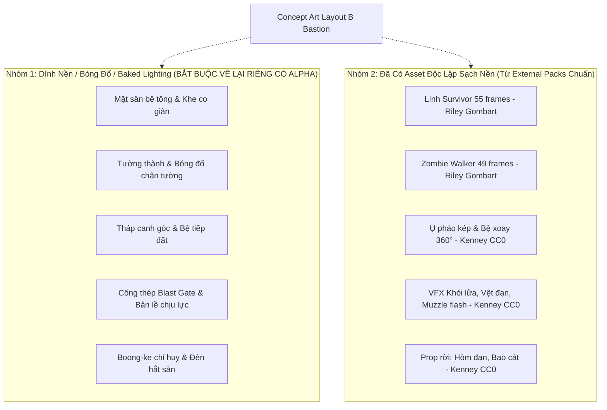
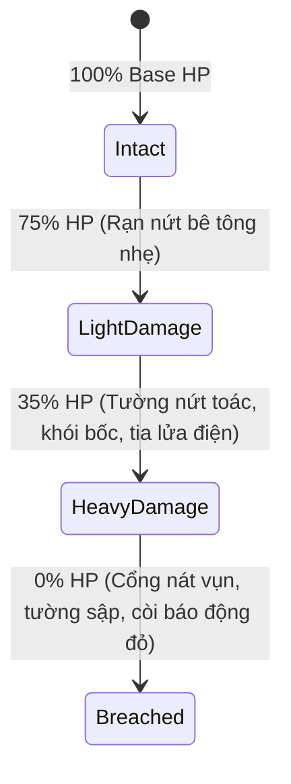

# BÁO CÁO ĐÁNH GIÁ TÍNH KHẢ THI CHUYỂN ĐỔI TỪ CONCEPT ART SANG SPRITE SẢN XUẤT (ART_TO_SPRITE_FEASIBILITY.md)

> **Dự án**: Zombie Đại Chiến: Thành Trì Cuối Cùng (2D 9:16 Server-Authoritative Live Defense Monorepo)  
> **Giai đoạn**: ART APPROVAL GATE — Đánh Giá Kỹ Thuật Chuyển Đổi Asset  
> **Thời điểm**: 2026-11-08  
> **Mục tiêu**: Đánh giá chi tiết, khách quan về tính khả thi khi chuyển đổi bộ Concept Art (Layout B: Fortified Bastion) thành các sprite độc lập phục vụ Phaser 3.90 WebGL Renderer. Cam kết không crop ảnh thô sơ gây lỗi đồ họa, minh bạch hóa hiện trạng source layer và xác lập bảng thông số kỹ thuật chuẩn.

---

## I. Khẳng Định Hiện Trạng Source Layer Của Concept Art

1. **Bản chất file Concept hiện tại**:
   - Hai tác phẩm Concept Art ([`fortress_concept_bastion_1080x1920.png`](file:///C:/Users/admin/.gemini/antigravity/scratch/zombie-live/apps/game-client/public/assets/concept/fortress_concept_bastion_1080x1920.png) và [`combat_concept_bastion_1080x1920.png`](file:///C:/Users/admin/.gemini/antigravity/scratch/zombie-live/apps/game-client/public/assets/concept/combat_concept_bastion_1080x1920.png)) là **hình ảnh raster phẳng đơn lớp (Single-Layer Flattened Raster)**, không phải file Photoshop đa lớp (Multi-layer PSD) và không có các layer vector/alpha riêng biệt cho từng vật thể.
   - Toàn bộ các yếu tố: mặt nền bê tông, vệt dầu, khe co giãn, tường thành, bóng đổ chân tường, ánh sáng đèn chiếu, cổng thép và tháp canh đã được kết xuất (baked) hòa trộn trực tiếp vào nhau.

2. **Nguyên tắc kỹ thuật sống còn**:
   > [!CAUTION]
   > **TUYỆT ĐỐI KHÔNG CROP TRỰC TIẾP CÁC VẬT THỂ TỪ ẢNH CONCEPT PHẲNG**:
   > Việc dùng công cụ cắt hình chữ nhật hoặc trích xuất ma thuật (magic-wand selection) từ ảnh concept phẳng để đưa vào game sẽ gây ra các lỗi mỹ thuật nghiêm trọng:
   > - Viền vật thể bị lem nhem nền (fringing / halo artifact).
   > - Bóng đổ bị cắt cụt hoặc dính cứng góc chiếu cố định, khi lính hoặc quái vật di chuyển qua sẽ bị đè lớp bóng sai lệch.
   > - Bị rách hình học (visual gaps) khi cổng mở hoặc khi thành trì bị phá hủy vì không có lớp đồ họa nền phía sau.
   > - Không thể scale độc lập hoặc xoay chuyển linh hoạt trong Phaser Container.

---

## II. Phân Tích Khả Năng Tách Biệt Giữa Các Đối Tượng

### 1. Những đối tượng BỊ DÍNH NỀN, BÓNG ĐỔ VÀ ÁNH SÁNG (Tightly Fused Elements)
Các thành phần sau trong ảnh concept không thể tách rời bằng công cụ cắt thông thường:
- **Tường thành bê tông (Perimeter Ramparts)**: Phần chân tường đổ bóng dài xuống mặt sân bê tông phía nam. Phần đỉnh tường nhận ánh sáng xiên hướng tây bắc. Cạnh ngoài tiếp giáp với vùng đất hoang tiền tiêu.
- **Hai Tháp canh góc (Corner Watchtowers)**: Khối kiến trúc hình trụ tròn gắn liền với khúc ngoặt của bức tường và ăn sâu vào mặt nền với độ che khuất môi trường (Ambient Occlusion).
- **Cổng thép dập gân (Heavy Blast Gate)**: Khung cổng ăn liền vào 2 trụ bê tông chịu lực. Nếu cắt cánh cổng ra, vùng không gian bên trong cổng trong ảnh concept không có kết cấu thông lộ.
- **Bệ ụ súng lục giác (Hexagonal Turret Platforms)**: Vạch sơn vàng cảnh báo an toàn và bóng chân đế hòa vào vân sỏi bê tông sàn.
- **Boong-ke sở chỉ huy (Command Center Bunker)**: Đổ bóng râm xuống khoảng sân hậu cần và có vệt sáng hắt từ cửa boong-ke.

### 2. Những đối tượng ĐÃ CÓ ASSET ĐỘC LẬP SẠCH NỀN (Clean Alpha Assets)
Game client hiện đã sở hữu sẵn các asset đạt chuẩn tách lớp độc lập:
- **Nhân vật Lính Survivor**: 55 frames tách biệt (`idle`, `move`, `shoot`, `reload`, `feet`) từ Riley Gombart (CC-BY 3.0), hoàn toàn sạch nền alpha.
- **Kẻ địch Zombie Walker**: 49 frames tách biệt (`idle`, `move`, `attack`) từ Riley Gombart (CC-BY 3.0), hoàn toàn sạch nền alpha.
- **Vũ khí Ụ pháo**: Bệ xoay (`turret_base.png`, 64×64px) và nòng pháo kép (`turret_gun_dual.png`, 48×64px) từ Kenney (CC0), có khả năng xoay mượt mà 360 độ độc lập theo góc nhắm tới zombie.
- **Hệ thống VFX**: Tia lửa đầu nòng (`muzzle_flash.png`), khói lửa nổ (`hit_explosion.png`), vệt đạn (`bullet_tracer.png`) hoàn toàn độc lập.

---

## III. Danh Mục Thành Phần Kiến Trúc Cần Vẽ Lại Riêng (Dedicated Alpha Sprites)

Dựa trên bố cục đã định hình từ Concept Art Layout B, các thành phần kiến trúc sau đây sẽ được họa sĩ thiết kế / render riêng rẽ trên nền trong suốt (Clean Transparent Alpha Channel):

| Thành Phần Sprite | Kích Thước File Dự Kiến | Định Dạng | Mô Tả Thẩm Mỹ & Kỹ Thuật Cần Vẽ Riêng |
| :--- | :---: | :---: | :--- |
| **`bastion_ground_tile.png`** | 512×512 px | PNG (Tileable) | Mặt sàn bê tông dã chiến có khe co giãn liền mạch, có thể lặp (tile) vô hạn mà không lộ vết nối. |
| **`bastion_gate_frame.png`** | 320×140 px | PNG (Alpha) | Khung cổng thép chịu lực gắn 2 trụ bê tông cố định (Stationary Gate Arch). |
| **`bastion_blast_gate_left.png`** | 120×110 px | PNG (Alpha) | Cánh cổng cơ giới bên trái, có pít-tông thủy lực và sọc vàng đen hazard. |
| **`bastion_blast_gate_right.png`**| 120×110 px | PNG (Alpha) | Cánh cổng cơ giới bên phải, trượt mở sang 2 bên khi có sự kiện mở cổng. |
| **`bastion_wall_segment.png`** | 256×110 px | PNG (Alpha) | Đoạn tường bê tông cốt thép khối dày, có lỗ châu mai và gờ nổi 3D, dễ dàng ghép nối thành hàng dài. |
| **`bastion_watchtower.png`** | 220×220 px | PNG (Alpha) | Tháp canh tròn tiền tiêu nhìn từ trên xuống, đỉnh tháp có bao cát bảo vệ và chân đế độc lập. |
| **`bastion_turret_pad.png`** | 140×140 px | PNG (Alpha) | Bệ pháo lục giác kim loại dập đinh tán, có thể đặt tự do tại bất kỳ vị trí chiến thuật nào. |
| **`bastion_command_bunker.png`**| 320×140 px | PNG (Alpha) | Boong-ke kiên cố bọc thép, có cửa chống bom và khe tản nhiệt. |
| **`bastion_radar_dish.png`** | 64×64 px | PNG (Alpha) | Chảo ăng-ten radar riêng rẽ, cho phép xoay tròn 360° bằng tween trong runtime. |
| **`bastion_ammo_depot.png`** | 140×90 px | PNG (Alpha) | Cụm hòm đạn gỗ xanh quân sự và thùng phuy nhiên liệu dã chiến. |
| **`bastion_dragons_teeth.png`** | 160×60 px | PNG (Alpha) | Tuyến cọc bê tông chống xe cơ giới (răng rồng) để phân làn quái vật. |
| **`bastion_barbed_wire.png`** | 140×40 px | PNG (Alpha) | Cuộn dây thép gai concertina dã chiến làm chậm bước zombie. |

---

## IV. Yêu Cầu Animation & Trạng Thái Hư Hỏng (Damage & Dynamic States)

Để biến bối cảnh tĩnh thành một chiến trường sống động phục vụ tương tác TikTok LIVE, hệ thống cần các asset phụ trợ sau:

1. **Trạng thái Cổng chính (Blast Gate States)**:
   - *State 1 (Intact)*: Cổng đóng kín, đèn LED trung tâm màu xanh lam/vàng.
   - *State 2 (Damaged)*: Bề mặt bị móp méo do zombie cào cấu, có vết đạn xuyên và tia lửa chập điện (`gate_spark_anim`).
   - *State 3 (Breached/Destroyed)*: Cánh cổng bị xé toạc hoặc trượt mở mất kiểm soát khi HP thành trì chạm 0.
2. **Hệ thống Decals Hư Hại Tường Thành (Wall Damage Decals)**:
   - 3 sprite decal vết nứt trong suốt (`crack_small.png`, `crack_medium.png`, `crack_large.png`) được spawn đè lên tọa độ va chạm thay vì phải vẽ lại toàn bộ bức tường.
   - Particle khói đen (`smoke_puff.png`) bốc lên liên tục tại các điểm nứt vỡ khi HP < 50%.
3. **Ánh sáng chiến thuật động (Dynamic Tactical Lighting)**:
   - Sprite chùm sáng đèn pha rọi (`spotlight_cone.png`, 128×384px, hình nón bán trong suốt, Blend Mode: `ADD`).
   - Gắn vào đỉnh 2 tháp canh và xoay quét qua lại vùng xuất hiện zombie tạo không khí căng thẳng ban đêm.

---

## V. Bảng Kích Thước (Dimensions), Điểm Neo (Origin) và Tầng Sâu (Depth) trong Phaser

Để bảo đảm khi đưa vào code không bị sai lệch tỷ lệ hiển thị với lính và zombie (đang chuẩn hóa tại Display Height 44px), thông số dự kiến trong Phaser 3.90 như sau:

| Đối Tượng GameObject | Sprite Key | Kích Thước Sprite (px) | Tọa Độ Gốc Dự Kiến (x, y) | Điểm Neo (Origin) | Tầng Sâu (Depth) | Tương Tác Kỹ Thuật |
| :--- | :--- | :---: | :---: | :---: | :---: | :--- |
| **Mặt sân dã chiến** | `bastion_ground` | TileSprite (1080×1920) | (540, 960) | (0.5, 0.5) | **1** | Nền tĩnh tuyệt đối |
| **Dây thép gai & Răng rồng**| `bastion_dragons_teeth`| 160×60 | Phân bố y: 550–650 | (0.5, 0.5) | **3** | Phân luồng di chuyển zombie |
| **Tường thành trái** | `bastion_wall_left` | 420×110 | (210, 1420) | (0.5, 0.5) | **4** | Vật cản chặn zombie |
| **Tường thành phải** | `bastion_wall_right` | 420×110 | (870, 1420) | (0.5, 0.5) | **4** | Vật cản chặn zombie |
| **Khung cổng chính** | `bastion_gate_frame` | 320×140 | (540, 1420) | (0.5, 0.5) | **5** | Khung cổng cố định |
| **Cánh cổng thép** | `bastion_blast_gate` | 240×110 | (540, 1420) | (0.5, 0.5) | **6** | Nhận tween trượt mở/hư hỏng |
| **Tháp canh góc trái** | `bastion_watchtower_l`| 220×220 | (90, 1380) | (0.5, 0.5) | **7** | Nổi bật 3D góc chiến trường |
| **Tháp canh góc phải** | `bastion_watchtower_r`| 220×220 | (990, 1380) | (0.5, 0.5) | **7** | Nổi bật 3D góc chiến trường |
| **Bệ pháo Sentry (3 bệ)**| `bastion_turret_pad` | 140×140 | (280, 1480), (540, 1480), (800, 1480) | (0.5, 0.5) | **8** | Chân đế đỡ ụ pháo |
| **Bệ xoay Ụ pháo (Turret)**| `turret_base` | 64×64 | Trùng tọa độ bệ pháo | (0.5, 0.5) | **9** | Đỡ nòng súng xoay 360° |
| **Nòng pháo kép** | `turret_gun_dual` | 48×64 | Trùng tọa độ bệ pháo | (0.5, 0.7) | **10** | Xoay nhắm quái & giật nòng |
| **Lính phòng thủ (3 lính)**| `survivor_idle` | Display Height 44px | y: 1330–1360 (Trước cổng & bệ pháo) | (0.5, 0.5) | **11** | Hoạt ảnh nổ súng & tiếp viện |
| **Kẻ địch Zombie** | `zombie_move` | Display Height 44px | Di chuyển y: 250 ➔ 1380 | (0.5, 0.5) | **12** | Tiến công 3 làn, dính đạn |
| **Boong-ke chỉ huy** | `bastion_command` | 320×140 | (540, 1680) | (0.5, 0.5) | **13** | Khu hậu cần trung tâm |
| **Chảo Radar xoay** | `bastion_radar` | 64×64 | (540, 1640) | (0.5, 0.5) | **14** | Tween xoay liên tục |
| **Kho đạn dược tiếp tế**| `bastion_ammo_depot` | 140×90 | (250, 1680) | (0.5, 0.5) | **13** | Prop trang trí hậu phương |
| **Chùm sáng đèn pha** | `spotlight_cone` | 128×384 | Gốc gắn tại tháp canh | (0.5, 1.0) | **15** | BlendMode ADD, quét dã chiến |
| **VFX Nổ & Tên lửa** | `hit_explosion` | 128×128 | Tọa độ va chạm mục tiêu | (0.5, 0.5) | **16** | Bộc phá & khói lửa |
| **Giao diện HUD LIVE** | HUD Text & Bars | Theo tỉ lệ 1080×1920 | y: 80–220 & y: 1750–1900 | (0.5, 0.5) | **20** | TikTok Safe Zone chuẩn |

---

## VI. Nguồn Gốc, Bản Quyền & Giấy Phép Sử Dụng Thực Tế (License & Compliance)

Để phục vụ phát hành thương mại và phát trực tiếp trên TikTok LIVE mà không gặp bất kỳ tranh chấp bản quyền nào:

1. **Nhân vật Lính Survivor & Zombie Walker**:
   - Tác giả: **Riley Gombart**.
   - Giấy phép: **Creative Commons Attribution 3.0 (CC-BY 3.0)**.
   - Tuân thủ: Ghi công rõ ràng trong credits game và tài liệu `ASSET_LICENSE_MANIFEST.md`. Cho phép sử dụng và biến đổi thương mại.
2. **Vũ khí Turret & Môi trường cơ bản**:
   - Tác giả: **Kenney (Kenney.nl)**.
   - Giấy phép: **Creative Commons Zero 1.0 Universal (CC0 1.0 - Public Domain)**.
   - Tuân thủ: Tự do sử dụng hoàn toàn cho mọi mục đích mà không yêu cầu cấp phép đặc biệt.
3. **Bộ Concept Art & Bộ Sprite Kiến Trúc Bastion Mới**:
   - Bản quyền: **Project Proprietary / Zombie-Live Art Team**.
   - Quyền sở hữu: Thuộc toàn quyền sở hữu của dự án `zombie-live`, phục vụ độc quyền cho các phiên phát livestream của monorepo.

---

## VII. Đề Xuất Quy Trình Chuyển Đổi (Production Pipeline Tiếp Theo)

Sau khi Người Dùng xem xét 4 file ảnh concept trong gói `zombie_art_approval_concepts.zip` và chính thức **PHÊ DUYỆT ĐỊNH HƯỚNG MỸ THUẬT**:
1. **Bước 1 (Isolate Asset Production)**: Tạo/vẽ bộ 12 sprite kiến trúc độc lập có kênh alpha trong suốt dựa đúng tỷ lệ và bảng màu của Concept Art đã duyệt (không crop từ ảnh phẳng).
2. **Bước 2 (Atlas Generation & Texture Packing)**: Đóng gói toàn bộ sprite thành trì vào `bastion_atlas.png` kèm `bastion_atlas.json` để tối ưu số lượng Draw Calls của WebGL.
3. **Bước 3 (Renderer Integration)**: Tái cấu trúc `FortressRenderer.ts` nạp và lắp ráp cấu trúc Bastion từ Texture Atlas mới.
4. **Bước 4 (Verification & Polish)**: Kiểm tra hiển thị tại cả 2 độ phân giải 1080×1920 và 360×640, xác minh 60 FPS ổn định trước khi bàn giao.
